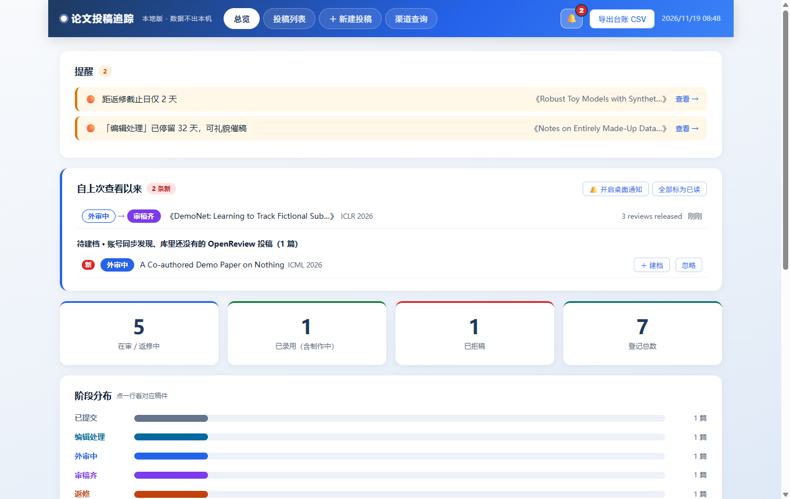
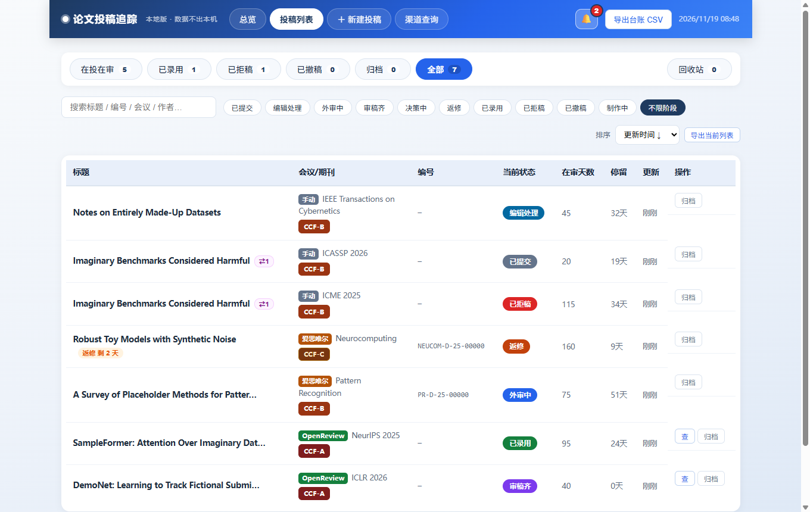
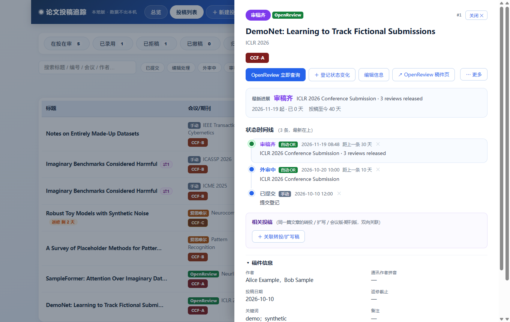

# RecordYourResearch

> A privacy-first, local-only tracker for your own paper submissions.

[中文](README.md) · [Data sources](DATA_SOURCES.md) · [Security](SECURITY.md) · [Contributing](CONTRIBUTING.md) · [Third-party notices](THIRD_PARTY_NOTICES.md)

RecordYourResearch (Chinese name: 论文投稿追踪 / 投稿记录本) keeps every paper you have submitted in one place: where it went, its current status, how long it has been under review, when the revision is due, and where it was resubmitted after a rejection. It runs only on your own computer (it listens on `127.0.0.1` by default) and keeps all data in a local folder. There are no accounts, no telemetry and no CDN.

This is v0.1, the first public release. **The user interface is in Chinese only.** UI labels are quoted in Chinese below so you can find them.

## Overview

- **OpenReview, fully automatic**: bind your own OpenReview account and sync all your submissions across venues (status, number of released reviews, decisions) with one click. While the app is running it syncs again about once a day.
- **Elsevier journals, semi-automatic**: look up the status on the official page yourself, then paste the page text into the app. It extracts the status, reviewer counts, dates and revision due date and records them on the timeline. There is also an experimental one-click query, off by default.
- **Other channels, manual**: IEEE, Springer, ACM, MDPI, CMT and others are logged by hand with an Editorial Manager / ScholarOne-style status vocabulary.
- **Built first for Chinese CS/AI researchers**: venues show CCF ranking and CAS journal-warning badges. If you have legitimate access to the CAS journal ranking (中科院分区表), the XR ranking (新锐期刊分区表) or JCR, you can import them yourself.

The project is not affiliated with Elsevier, OpenReview, Clarivate, the National Science Library of the Chinese Academy of Sciences (中国科学院文献情报中心), 新锐学术 or the China Computer Federation (CCF). See the [disclaimer](#disclaimer).

### Current limitations

- Single user, single machine: no login, no sharing, no multi-device sync, no mobile app.
- Only OpenReview is fully automatic. For Elsevier you look up the status on the official page yourself and solve any captcha there. Other channels are manual.
- PDF parsing is rule-based, not OCR. Scanned or encrypted PDFs cannot be parsed, and extracted data must be checked before you save it.
- OpenReview accounts with multi-factor authentication (MFA) are not supported for automatic sync.
- OpenReview account sync covers venues on API v2 (api2, most venues since 2023). For older venues that exist only on the old API, fill in the forum id under 「编辑信息」 and use the single-paper query.
- Licensed ranking data (CAS, XR, JCR) is not included.
- Windows 10/11 is the primary platform; macOS and Linux are best effort.

## Features

- **New-submission wizard ("＋ 新建投稿")**: drop a PDF and the app extracts the title, authors, abstract and keywords locally with PyMuPDF. It also picks up the conference or journal and year, including the headers of double-blind CVF, NeurIPS, ICLR, ICML, ECCV and AAAI submissions. From an Editorial Manager cover page it reads the manuscript number and corresponding author, and it finds DOI / arXiv ids and the cover-letter date. It preselects the tracking channel and autocompletes the venue name with ranking badges. Everything is a draft until you confirm it.
- **Status timeline**: one timeline per submission (newest first). Raw statuses from every channel are normalised to one set of stages:
  已提交 submitted → 编辑处理 editor → 外审中 under review → 审稿齐 reviews complete → 决策中 decision → 返修 revision → 已录用 accepted / 已拒稿 rejected / 已撤稿 withdrawn / 制作中 in production.
  The app shows days under review and days in the current stage. It warns you when a revision deadline is 3 days away or past, and nudges you when a paper has been with the editor for more than 4 weeks. Backdated entries never override the current status, and automatic channels only record real changes.
- **Overview ("总览")**: a "since your last visit" inbox lists every status change found by OpenReview sync or polling, including when you click 「同步我的投稿」 or 「立即全量轮询」 yourself. Manual entries, pasted official results, the single-paper 「立即查询」 and 「一键查稿」 are not listed. A bell badge and `(N)` in the tab title show the unread count. Desktop notifications are optional and only fire while the page is open, even in a background tab. The page checks for changes every 5 minutes and when you switch back to it. The overview also shows submissions found on OpenReview but not yet in your library (待建档: import, import and link, or ignore), reminders, stats and the stage distribution.
- **List ("投稿列表")**: categories 在投在审 / 已录用 / 已拒稿 / 已撤稿 / 归档 / 全部 / 回收站 (active, accepted, rejected, withdrawn, archived, all, recycle bin), with a stage filter, search and sorting. You can export the current list as CSV: it opens directly in Excel (UTF-8 with BOM), is safe against formula injection and has a dated filename. The top-bar 「导出台账 CSV」 exports everything (archived included, recycle bin excluded).
- **Detail drawer**: a latest-status card, the timeline, related submissions (转投 resubmitted / 扩写 extended / 会议版·期刊版 conference & journal versions…) and links to the OpenReview page or the submission system. If you leave the submission-system link empty, the app infers it from the channel or manuscript number. The resubmit flow copies a rejected paper into a new submission and suggests CCF venues in the same field at the same or one lower rank. Deleting moves a submission to the recycle bin (回收站), where it can be restored; after 30 days it is permanently deleted together with its PDF (the purge runs with the daily background tasks, so not under `--no-daily`). Archiving, moving to the recycle bin, unlinking and deleting a timeline entry can be undone from the notification (「撤销」). Every view has its own URL (deep links, browser back/forward).
- **Ranking badges**: CCF-A/B/C (CCF list 2026) and ⚠ CAS warning-list badges work out of the box. Imported CAS, XR and JCR data adds more badges. Tooltips show the source and edition. Badges use strict matching only, and workshops or "Findings" never inherit the main venue's rank.

## Screenshots

> All submissions, authors and numbers in the screenshots are made-up demo data.







## Quick start

Requirements: Python 3.10 or newer (CI tests 3.10, 3.12 and 3.14). Windows 10/11 is the primary platform; macOS and Linux are best effort.

```bash
git clone https://github.com/avalanchezy/RecordYourResearch.git
cd RecordYourResearch
python -m pip install -r requirements.txt
python run.py
```

Open <http://127.0.0.1:8765>. Press `Ctrl+C` in the terminal to stop.

A virtual environment is recommended:

```bash
python -m venv .venv
.venv\Scripts\activate          # Windows
source .venv/bin/activate       # macOS / Linux
python -m pip install -r requirements.txt
python run.py
```

PowerShell may block `.venv\Scripts\activate` because of its execution policy. You can skip activation and call the environment's Python directly: `.venv\Scripts\python -m pip install -r requirements.txt`, then `.venv\Scripts\python run.py`.

**One-click start**: double-click `start.bat` on Windows, or run `./start.sh` (or `sh start.sh`) on macOS or Linux. The script creates `.venv`, installs the requirements, starts the app and opens your browser once the server is ready. It re-runs the install automatically if a previous install failed or the requirements changed. If something still looks broken, delete `.venv` and run the script again. Packages installed this way live only in `.venv`, so run the tools with `.venv\Scripts\python` (`.venv/bin/python` on macOS/Linux).

**Try it with demo data**: fill a new, empty folder with made-up submissions, then point the app at it. This makes no network calls and leaves your real data alone.

```bash
python tools/demo_seed.py --data-dir ./demo-data
python run.py --data-dir ./demo-data --no-daily --open
```

**Tests**:

```bash
python -m pip install -r requirements-dev.txt
python -m pytest
```

The tests use synthetic data only and block real network access.

> [!WARNING]
> The app binds to `127.0.0.1` by default and has **no login**. Anyone who can reach the port can read and change all your data. Never expose it with `--host 0.0.0.0` on a network you don't trust, and don't host it for other people. See [SECURITY.md](SECURITY.md).

## Configuration

```bash
python run.py --port 8765 --host 127.0.0.1 --data-dir PATH --no-daily --open
```

| Option | Default | Meaning |
|---|---|---|
| `--port` | `8765` | Port. If RecordYourResearch is already running on it, no second copy starts: with `--open` (start.bat and start.sh always pass it) the browser opens to the running one, otherwise the address is printed and run.py exits. If another program uses the port, pick a different one. |
| `--host` | `127.0.0.1` | Bind address. **Do not change it to `0.0.0.0`.** |
| `--data-dir PATH` | `./data` | Data folder |
| `--no-daily` | off | Disable the daily background tasks: automatic backup, recycle-bin purge and OpenReview daily sync |
| `--open` | off | Open the browser once the server is accepting connections |

Environment variables: `PAPER_TRACKER_DATA_DIR=PATH` (same as `--data-dir`), `PAPER_TRACKER_PORT=8765` (default port; `--port` wins) and `PAPER_TRACKER_NO_DAILY=1` (same as `--no-daily`).

The data folder contains:

- `tracker.db`: the main database;
- `pdfs/`: attached PDFs;
- `uploads/`: PDFs being parsed. Unsaved ones older than 24 hours are removed at startup and by the daily task;
- `backups/auto/`: automatic and manual backups, of which the 14 most recent are kept;
- `rankings/rankings.db`: the local ranking database;
- `elsevier_device_id`: a random device id for the experimental Elsevier feature, created on the first one-click query or dictionary fetch.

## Data and privacy

- All your data stays in the data folder (default `./data`, excluded by `.gitignore`). Don't commit it or put it in a publicly shared folder.
- No telemetry, analytics, crash reports or update checks. Vue is bundled in `web/vendor/`, so nothing is loaded from a CDN. FastAPI's API debug pages (`/docs`, `/redoc`) and `/openapi.json` are turned off on purpose: the debug pages load scripts from a CDN, and the app doesn't need them.
- The app makes network calls in only two cases:
  1. If you bind an OpenReview account, it calls the official OpenReview API to log in and read your own submissions.
  2. Once you enable the experimental Elsevier one-click query, each query you click sends the manuscript number, the corresponding author's name in pinyin, the journal acronym and a random device id to Elsevier China's manuscript-query service (`dsp-api.elsevier.cn`). The 「拉取期刊缩写字典」 (journal-acronym dictionary) button, shown only while the feature is on, sends only the random device id.
- PDFs are parsed locally. The browser hands the file to the app running on your machine.
- The browser's localStorage keeps only UI preferences, such as the list category and sort order.
- External links in the drawer (OpenReview page, submission system) open in your browser only when you click them.
- The database and PDFs are not encrypted on disk (only the OpenReview password is protected), so use full-disk encryption.

## Channels

### OpenReview (automatic)

The OpenReview API no longer allows anonymous reads (they get 403 ChallengeRequired), so you have to bind your own account on the "渠道查询" (channels) page.

- **Credential storage**: on Windows, DPAPI encryption bound to your Windows user. On macOS and Linux, the Keychain or Secret Service via the `keyring` package. If no secure store is available, the app **refuses to store** the password. The login token is kept in memory only. Unbinding deletes the stored credential, including the copies in backup files.
- **Sync my submissions ("同步我的投稿")**: pulls every OpenReview submission you are an author of, across all venues, and matches them to your library by forum id or by same venue and title. Status comes from the venue id, released reviews and meta-reviews, decisions, withdrawals and desk rejections; TMLR states are supported too. Unknown submissions appear as 待建档 items for you to import or ignore. Account sync covers venues on OpenReview's API v2 (api2, most venues since 2023). For older venues that exist only on the old API, fill in the forum id under 「编辑信息」 and use the single-paper query.
- **Daily background sync**: while the app runs, it syncs your account about once every 23 hours. It then polls OpenReview papers that were not checked in the last 6 hours, 1 second apart, and catches up after sleep or restart.
- **Staying gentle**, in background and manual syncs and polls alike:
  - It stops at the first login failure.
  - On ChallengeRequired it never tries to get around the challenge and does not fall back to the old API; it stops the round.
  - On HTTP 429 it waits for Retry-After (at most 60 s), retries once and stops the round if it is still rate-limited.
- **Single-paper query and full poll**: 「OpenReview 立即查询」 in the drawer and 「立即全量轮询」 on the 渠道查询 page. Without a forum id, the app matches by title within the same venue; the titles must be identical once case, spaces and punctuation are ignored. You can also enter the forum id under 「编辑信息」.
- **Venue-id templates**: for NeurIPS, ICLR, ICML, CVPR, ICCV, ECCV, COLM, AAAI, IPMI, ACCV, BMVC and TMLR, the venue id is assembled from the venue name and year (e.g. `NeurIPS.cc/2026/Conference`). For other venues, enter the venue id yourself.
- **MFA accounts are not supported yet.** Track those papers manually; please don't turn off MFA for this tool.

> [!IMPORTANT]
> Run the app locally, for the account owner only. Don't host it for other people or hold their OpenReview accounts: OpenReview's terms do not allow letting third parties use the system on your behalf.

### Elsevier journals (semi-automatic)

**Recommended: paste the official result.** Open an official Elsevier status page yourself, such as the Editorial Manager author centre, Track your submission or Elsevier China's manuscript query page (Chinese and English pages are both supported), and solve any captcha. Copy the whole page, then in the drawer click "📋 粘贴官方结果" → "🔍 解析预览" (preview) → "✓ 记入时间线" (record). The adaptive parser extracts the status, reviewer counts (invited / accepted / completed), dates, the revision due date, the manuscript number and the journal name. It refuses to write if the pasted manuscript number does not match the paper (ignoring revision suffixes such as R1), and it skips results identical to the previous one. With a revision status it also saves the revision due date, and the official submission date replaces the one you entered. If nothing is recognised (for example, you pasted a captcha page), nothing is written.

**Experimental: Elsevier one-click query ("爱思唯尔一键查稿"), off by default.** Turn it on explicitly with "开启实验功能…" in the "爱思唯尔期刊" panel of the "渠道查询" page. Elsevier papers then get a "一键查稿（实验）" button ("查" in the list). It queries Elsevier China's manuscript-query service with the manuscript number, the corresponding author's pinyin (e.g. `XIAOMING WANG`) and the journal acronym (usually the prefix of a number like `ABC-D-25-00000`). It runs only when you click, at most once per manuscript per 24 hours. On any captcha or risk-control response it stops and asks you to look the status up manually, then paste it. If the service returns a status the app does not recognise, nothing is written; log it manually instead. While the feature is on, the 「拉取期刊缩写字典」 button in the same panel fetches the journal-acronym list from the same service, sending only the random device id.

> [!CAUTION]
> This is not an official API that Elsevier offers to third-party tools. It may stop working at any time and may conflict with Elsevier's website terms. Use it at your own risk.

### Other channels (manual)

Use "＋ 登记状态变化" (log a status change) in the drawer. Pick a stage and, optionally, a raw status from an Editorial Manager / ScholarOne-style list (Submitted to Journal, With Editor, Under Review, Required Reviews Complete, Decision in Process, Revise - Major, …). You can backdate an entry and set a revision due date.

## Ranking data

| Dataset | Included | Notes |
|---|---|---|
| CCF list of recommended international conferences and journals (7th edition, 2026) | yes | `data-sources/ccf_2026.json` |
| CAS international journal warning lists 2024 & 2025 | yes | `data-sources/cas_warning_lists.json` |
| 中科院分区表 (CAS journal ranking, upgraded edition) | no | subscriber database, import your own |
| 新锐期刊分区表 (XR journal ranking) | no | terms restrict reuse, import your own |
| JCR | no | Clarivate forbids redistribution and derivative databases, import your own |

The included files have their own terms and are **not** covered by the AGPL; see [DATA_SOURCES.md](DATA_SOURCES.md). To import data you are entitled to use:

```bash
python tools/build_rankings.py --cas FILE --xr FILE --jcr FILE
```

- If you installed with start.bat or start.sh, use `.venv\Scripts\python` (`.venv/bin/python` on macOS/Linux) instead of `python`.
- Pass only the files you have.
- Each run rebuilds the whole ranking database, so pass every CSV you want to keep.
- Optional `--cas-edition`, `--xr-edition` and `--jcr-edition` labels appear in badge tooltips. Use `--data-dir PATH` if you changed the data folder.
- Restart the app afterwards.

Expected columns (CSV with a header row, saved as UTF-8 or GBK, so Excel's 「CSV（逗号分隔）」 format on Chinese Windows works; required columns are listed in [DATA_SOURCES.md](DATA_SOURCES.md#english-summary)):

- CAS: `Journal`, `ISSN/EISSN`, `大类`, `大类分区`, `Top`, `Web of Science`
- XR: `Journal`, `ISSN`, `EISSN`, `大类中文名`, `大类新锐分区`, `Top`, `预警标记`
- JCR: `Journal`, `ISSN`, `EISSN`, `IF(<year>)`, `Category_1`, `IF Quartile(<year>)_1`

## Backup and restore

- The app backs up the database every day to `data/backups/auto/`; the first check runs about 90 seconds after start. You can also click "立即备份" (back up now) on the "渠道查询" page. Manual backups go into the same folder, and the 14 most recent copies are kept in total. The backups card shows the folder relative to the data folder, and 「复制路径」 copies the full path. Before a schema migration the app also keeps a `premigrate-*.db` copy.
- Backups contain the database only, **not the PDFs**. For a full backup, stop the app and copy the whole data folder.
- `--no-daily` also disables automatic backups.
- **Restore**: stop the app, keep a copy of the current `data/tracker.db`, copy the backup over `data/tracker.db`, then start the app again. After restoring on another computer or user account, unbind and re-bind OpenReview, because the saved password can only be read where it was stored.

## FAQ

- **Why must I bind an OpenReview account?** Anonymous API reads are blocked. The app only reads what your account can see.
- **"Needs re-binding" after moving to a new computer?** Expected: stored passwords are tied to the original machine and user. On the 「渠道查询」 page, unbind and bind your OpenReview account again.
- **The Elsevier query says a captcha is required.** By design the app never bypasses it. Look the status up on the official page and paste it.
- **A status was not recognised or went to the wrong stage.** Open an "Unrecognized status" issue with the raw status text, the channel and the expected stage only.
- **No badge or no CAS rank for a journal?** CAS, XR and JCR data must be imported. Badges use strict matching, so try the venue's full name.
- **Does it keep syncing when the browser is closed?** Yes, as long as `run.py` is running. Desktop notifications need the page open.
- **Can I host it for my lab?** No. There is no login, and OpenReview's terms forbid third-party use on your behalf. Everyone should run their own copy.
- **Port 8765 is in use.** If RecordYourResearch is already running there, starting it again does not start a second copy; with `--open` (or start.bat / start.sh) it opens the browser to the running one. If another program uses the port, use `--port 8766`.
- **start.bat says Python is not found.** Install Python 3.10 or newer (CI tests 3.10, 3.12 and 3.14) and tick "Add python.exe to PATH" during installation.
- **PowerShell refuses to run `activate`.** That is PowerShell's execution policy. Skip activation and call `.venv\Scripts\python run.py` directly.
- **A tool says a module is missing.** The packages live in `.venv`; run tools with `.venv\Scripts\python` (`.venv/bin/python` on macOS/Linux). If start.bat or start.sh itself looks broken, delete `.venv` and run the script again.

## Disclaimer

- This is an independent open-source project. It is not affiliated with, endorsed or sponsored by Elsevier, OpenReview, Clarivate, the National Science Library of CAS, 新锐学术 or CCF. Names and trademarks belong to their owners and are used only to describe compatibility. No logos are used.
- Status information comes from your own entries, pasted official pages or responses from official services, and may be late or wrong. **The official submission system and the editorial office are always authoritative.** Don't rely on this tool for deadlines.
- Ranking badges are for reference only and are not an evaluation of any venue or paper; bundled data may be outdated or contain transcription errors. CCF itself says its list is not meant as a basis for academic evaluation.
- The Elsevier one-click query is unofficial and experimental. Use it at your own risk.
- You are responsible for complying with the terms of the services you use.
- The software is provided "as is", without warranty; see sections 15 and 16 of the AGPL-3.0.

## Licence

- Code: [GNU AGPL-3.0-or-later](LICENSE), because the project depends on PyMuPDF, which is licensed under AGPL-3.0 (or an Artifex commercial licence).
- Files under `data-sources/` are **not** covered by the AGPL; see [DATA_SOURCES.md](DATA_SOURCES.md).
- The bundled Vue 3.4.38 (`web/vendor/vue.global.prod.js`) is MIT-licensed; see [THIRD_PARTY_NOTICES.md](THIRD_PARTY_NOTICES.md) for all third-party licences.
- Contributions are welcome, see [CONTRIBUTING.md](CONTRIBUTING.md). Report security issues privately as described in [SECURITY.md](SECURITY.md).
