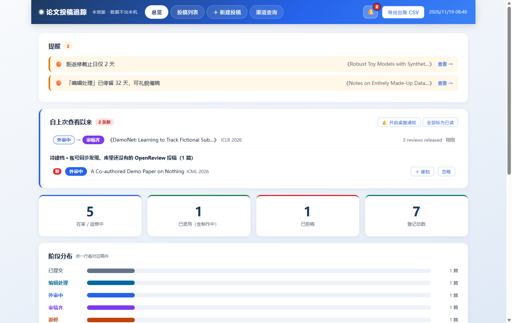
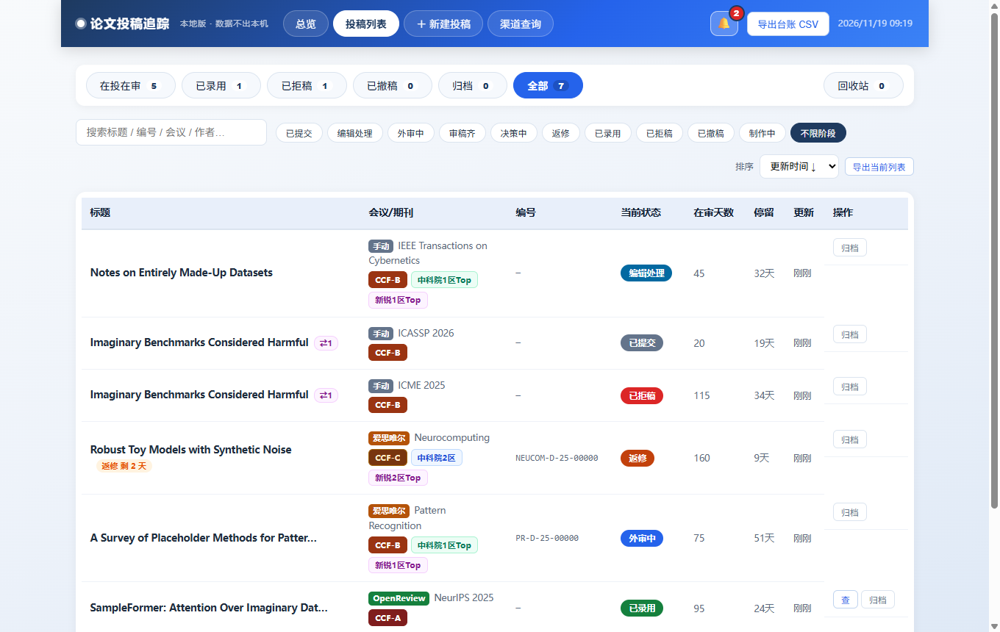
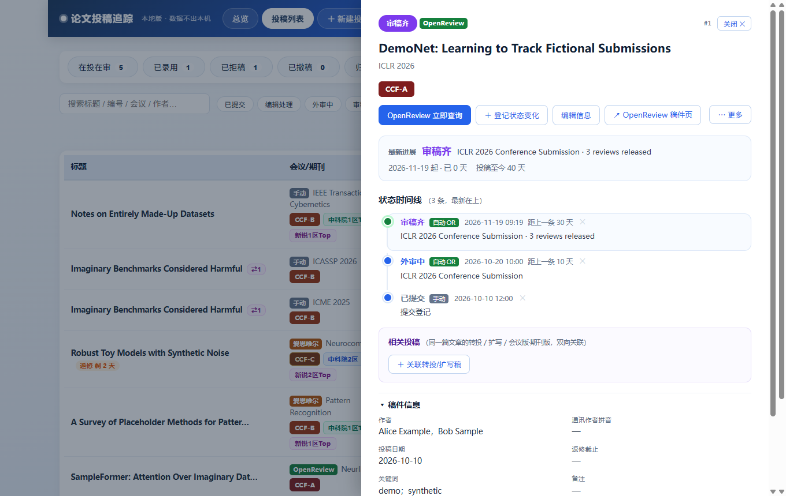

# RecordYourResearch · 论文投稿追踪

> 投稿记录本：在你自己电脑上运行、隐私优先的论文投稿状态追踪工具。

[English](README.en.md) · [数据来源](DATA_SOURCES.md) · [安全说明](SECURITY.md) · [参与贡献](CONTRIBUTING.md) · [第三方声明](THIRD_PARTY_NOTICES.md)

RecordYourResearch 把你投出去的每一篇论文记在一个地方：投到了哪里、现在是什么状态、在审了多少天、返修什么时候截止、被拒后转投到了哪里。它只在你自己的电脑上运行（默认只监听 `127.0.0.1`），所有数据都在本机的一个数据文件夹里：没有账号体系、没有遥测、不从任何 CDN 加载资源。

当前版本 v0.4.0，界面有**中文和英文**两种：点顶栏右上角的「EN / 中文」一键切换，会记住你的选择；浏览器语言不是中文时默认显示英文。

## 简介

- **OpenReview 全自动**：绑定你自己的 OpenReview 账号后，一键同步你名下所有会议的投稿（状态、已发布的审稿意见数、决策），程序运行期间每天自动再同步一次。
- **爱思唯尔期刊半自动**：你在官方页面查到状态后，把整页文字粘贴进来，程序自动解析状态、审稿人统计、日期和返修截止日并记入时间线。另有一个默认关闭的实验功能「爱思唯尔一键查稿」。
- **其他投稿系统半自动（测试版）**：IEEE、Springer、Taylor & Francis、Wiley、MDPI，以及勤云、方正、知网腾云等中文期刊系统。你自己登录官方投稿系统，把列出稿件的那一页整页复制，粘贴进「从投稿系统导入」；程序在本机解析出每篇稿件的编号、标题、状态和日期，你核对后再记入时间线。程序不会登录这些系统，也不联网。认不出的情况仍可以手动登记。
- **优先照顾中国计算机 / 人工智能方向的研究者**：会议、期刊旁直接显示 CCF 推荐目录等级、中科院分区（升级版 2025）、新锐期刊分区（2026）和中科院国际期刊预警徽章，开箱即用、不需要联网；如果你有 JCR 的使用授权，也可以自己导入 JCR。

本项目与爱思唯尔（Elsevier）、OpenReview、科睿唯安（Clarivate）、中国科学院文献情报中心、新锐学术、中国计算机学会（CCF）均无任何关联，见[免责声明](#免责声明)。

### 目前的限制

- 单人、单机使用：没有登录功能，不支持多人共享或多设备同步，也没有手机端。
- 只有 OpenReview 是全自动的。爱思唯尔和其他投稿系统都需要你自己登录官方页面（验证码由你完成），再把页面复制粘贴进来；没法粘贴或认不出的，只能手动登记。
- 「从投稿系统导入」是测试版：按页面文字的规则解析，是用照各系统公开文档构造的示例页面测出来的，没有在真实账号上验证过。投稿系统改版后可能认不出或归错阶段，导入前请核对预览。
- PDF 解析基于版式规则，抽取结果建档前需要你核对。加密 PDF 无法解析；扫描件（没有文字层）需要装可选的 OCR 组件。
- 开启了多因素认证（MFA）的 OpenReview 账号暂不支持自动同步。
- OpenReview 账号同步只覆盖使用 API v2（api2，2023 年以来的大多数会议）的会议；只在旧版 API 上的更早会议，需要在「编辑信息」里填 forum ID 后单篇查询。
- JCR（影响因子与分区）不随项目附带，因为 Clarivate 禁止再分发；有授权的话可以自己导入。
- 主要在 Windows 10/11 上开发和测试；macOS / Linux 尽力支持。

## 功能

### 新建投稿：把 PDF 拖进来

- 拖入（或选择）投稿 PDF，在本机用 PyMuPDF 按规则抽取：标题、作者、摘要、关键词、会议 / 期刊与年份（识别 CVF、NeurIPS、ICLR、ICML、ECCV、AAAI 等模板的页眉页脚，包括双盲评审稿的匿名作者行）、Editorial Manager 投稿封面页上的稿件编号与通讯作者、DOI / arXiv 编号，以及 cover letter 的落款日期（作为投稿日期的参考）。
- 自动预选追踪渠道：识别到 OpenReview 承办的会议 → OpenReview；Editorial Manager 封面页 → 爱思唯尔（按 CCF 目录确认出版社不是爱思唯尔时改为手动）；其他 → 手动。都可以改。
- 会议 / 期刊名称支持联想补全（简称 → 全称，如 `ESWA`、`NeurIPS`），下拉里直接显示分级徽章。
- 抽取结果只是草稿，确认、补全后才建档；没有 PDF 也可以直接手填。

### 状态时间线

- 每篇投稿一条状态时间线（最新在上）：每条记录来源（手动 / OpenReview / 爱思唯尔 / 粘贴·投稿系统）、发生时间、原始状态文字，以及审稿人统计、决策等信息。
- 各渠道五花八门的状态文字统一归入同一套阶段：

  **已提交 → 编辑处理 → 外审中 → 审稿齐 → 决策中 → 返修 → 已录用 / 已拒稿 / 已撤稿 / 制作中**

- 当前状态取时间线上发生时间最新的一条；补录的历史记录不会覆盖当前状态。自动渠道只在状态真的变化时才新增记录，不会刷屏。
- 自动计算在审天数（出结果后停止计时）和在当前阶段停留的天数。
- 提醒：返修截止日倒计时（剩 3 天以内或已逾期时在总览提醒）；「编辑处理」超过 4 周时提示可以礼貌催稿。
- 记错的记录可以删除（可撤销）。

### 总览

- **自上次查看以来**：OpenReview 同步或轮询发现的状态变化都会列在这里，包括你自己点「同步我的投稿」或「立即全量轮询」时发现的；手动登记、粘贴的官方结果、「从投稿系统导入」的结果，以及单篇「立即查询」和「一键查稿」的结果不列入。顶栏铃铛显示未读数，浏览器标签页标题前也会显示 `(N)`；可以一键全部标为已读（可撤销）。
- 页面开着时（放在后台标签页也行）每 5 分钟检查一次新变化，切回页面时也会检查；你允许的话会弹出系统桌面通知，否则在页面里提示。
- **待建档**：OpenReview 账号同步发现、但库里还没有的投稿，可以一键建档、建档并关联到疑似的转投 / 扩写稿，或忽略。
- 提醒、统计卡片、阶段分布和最近动态：点统计卡片或阶段分布跳到对应的列表，点提醒或动态打开那篇投稿。

### 投稿列表

- 分类：在投在审 / 已录用 / 已拒稿 / 已撤稿 / 归档 / 全部 / 回收站；分类内还可以按阶段筛选。
- 搜索标题、编号、会议 / 期刊、作者、备注；按更新时间、会议 / 期刊、会议 DDL、返修截止、投稿日期排序。会记住你上次用的分类和排序。
- 每行显示追踪渠道、分级徽章、返修倒计时、DDL 倒计时和关联稿件数，可以直接「查」或归档。
- **导出当前列表**：按当前的分类、阶段、搜索和排序导出 CSV。UTF-8 带 BOM，Excel 直接打开不乱码；以 `=`、`+`、`-`、`@` 开头的单元格会被转义，防止公式注入；文件名带日期。顶栏的「导出台账 CSV」导出全部投稿（含归档，不含回收站）。

### 详情抽屉

- 最新进展卡片（当前阶段、停留天数、在审天数、返修截止、审稿人统计、决策）、状态时间线（默认显示最近 5 条）、相关投稿，以及可折叠的稿件信息和摘要。
- 常用操作：OpenReview 立即查询、粘贴官方结果、从投稿系统导入（手动渠道的期刊稿件）、登记状态变化、编辑信息；「⋯ 更多」里有打开 PDF 原件、OpenReview 稿件页、投稿系统，以及转投 / 扩写、归档、移到回收站。
- 投稿系统链接可以自己填（ScholarOne、CMT 等）；不填时按渠道或编号推断：OpenReview 会议页、由 `XXX-D-yy-nnnnn` 格式的编号推断 Editorial Manager 期刊站点、MDPI SuSy。
- **转投**：被拒或撤稿后，一键把标题、作者、摘要、关键词（可选连同 PDF）复制成一篇新投稿并自动建立关联；同时按本地 CCF 目录推荐同领域、同级或低一级的会议 / 期刊。
- **相关投稿**：转投 / 扩写 / 会议版·期刊版 / 同数据集 / 同方法，双向可见。
- **回收站**：删除先进回收站，可以恢复，30 天后连同 PDF 原件自动彻底删除（清理随每日后台任务执行，用 `--no-daily` 启动时不会清理）。归档、移到回收站、解除关联、删除时间线记录都可以在提示条里「撤销」。
- **网址路由**：页面、筛选条件和打开的抽屉都对应一个网址（如 `#/list?cat=invest&sub=12`），可以收藏、刷新，浏览器的前进 / 后退可用（后退会先关闭抽屉）。有未保存的编辑时离开会先问你。

### 分级徽章

- 开箱即用：CCF-A / B / C（CCF 推荐目录 2026）、中科院 N 区 / Top（中科院分区表升级版 2025）、新锐 N 区 / Top（新锐期刊分区表 2026），以及 ⚠ 预警（中科院国际期刊预警名单 2024 / 2025、新锐期刊分区表里的预警标记）。导入 JCR 后还会显示 JCR 分区与影响因子。
- 鼠标悬停在徽章上可以看到数据来源和版本，例如「中科院分区表升级版 2025（中科院文献情报中心）」「新锐期刊分区表 2026（xr-scholar.com）」；你自己导入的数据会标「（你导入的数据）」。
- 徽章只用严格匹配（简称 / 全称精确命中、少量公认别名，或相似度很高且唯一），宁缺毋滥；Workshop、Findings 等卫星活动不会继承主会的等级。
- 「渠道查询」页有「期刊 / 会议分级速查」。

## 截图

> 截图中的稿件、作者和编号均为虚构的演示数据。







## 快速开始

### 环境要求

- Python 3.10 或更高（CI 测试 3.10 / 3.12 / 3.14）
- Windows 10/11 是主要支持平台；macOS / Linux 尽力支持
- 一个现代浏览器（Chrome、Edge、Firefox 等）

### 安装与启动

```bash
git clone https://github.com/avalanchezy/RecordYourResearch.git
cd RecordYourResearch
python -m pip install -r requirements.txt
python run.py
```

然后在浏览器打开 <http://127.0.0.1:8765>，在运行 `run.py` 的窗口按 `Ctrl+C` 停止。

建议装在虚拟环境里：

```bash
python -m venv .venv
.venv\Scripts\activate          # Windows
source .venv/bin/activate       # macOS / Linux
python -m pip install -r requirements.txt
python run.py
```

Windows 的 PowerShell 可能因为执行策略（Execution Policy）拦截 `.venv\Scripts\activate`。不激活也可以，直接调用虚拟环境里的 Python：

```powershell
.venv\Scripts\python -m pip install -r requirements.txt
.venv\Scripts\python run.py
```

**一键启动**：Windows 上双击 `start.bat`；macOS / Linux 上运行 `./start.sh`（或 `sh start.sh`）。脚本会创建 `.venv`、安装依赖、启动程序，并在服务就绪后打开浏览器。上次安装失败或依赖清单有变化时，脚本会自动重新安装；如果还是不正常，删掉 `.venv` 文件夹再运行一次脚本。

> [!NOTE]
> 用脚本安装的依赖只在 `.venv` 里。运行 `tools/` 下的脚本时请用 `.venv\Scripts\python`（macOS / Linux 为 `.venv/bin/python`），例如 `.venv\Scripts\python tools\demo_seed.py --data-dir demo-data`。

第一次启动时会创建数据文件夹（默认 `./data`），并用随项目附带的 CCF 目录、预警名单、中科院分区表 2025 和新锐期刊分区表 2026 生成本地分级库，需要几秒钟。

**先用演示数据试试**：一条命令在 8766 端口另起一个实例，用 `demo-data/` 里的虚构投稿（第一次运行时自动生成）。不联网，不会碰你的真实数据，界面上标着「演示数据」；删掉 `demo-data/` 就能重来。

```bash
python run.py --demo --open
```

[docs/DEMO.md](docs/DEMO.md) 是英文的演示脚本（5 分钟视频分镜和现场演示场景），配套的可粘贴演示页面在 [docs/demo/](docs/demo/)。想灌到自己指定的目录，可以先 `python tools/demo_seed.py --data-dir 路径`，再 `python run.py --data-dir 路径 --no-daily --open`。

### 可选：截图识别（OCR）

不装也能正常使用。装上以后，粘贴框里可以直接 `Ctrl+V` 粘贴投稿系统页面的**截图**（或点「📷 识别截图」选一张图），程序先把截图识别成文字，再走原来的解析预览 → 你确认 → 记入时间线；扫描版 PDF（没有文字层）在新建向导里也会自动用 OCR 读首页。

```bash
python -m pip install -r requirements-ocr.txt      # 一键启动的用户：.venv\Scripts\python -m pip install -r requirements-ocr.txt
```

装完重启程序即可。引擎是 [RapidOCR](https://github.com/RapidAI/RapidOCR)（PaddleOCR 模型的 ONNX 版本）：纯 CPU、离线运行，中英文模型随安装包附带（约 27 MB），截图不会离开你的电脑。

- OCR 只负责把图片变成文字；状态、人数、日期仍由规则解析，写入前照常预览确认。识别出的文字留在框里，认错的字可以直接改。
- 预览上方会显示识别了几行、最低置信度多少；最低置信度低于 85% 时标黄，请对照截图核对数字。
- 由截图识别写入的记录，时间线上带一个「OCR」标记，鼠标悬停可以看到置信度。
- 为什么不内置一个 1B 级的视觉大模型：体积大（1–2 GB）、CPU 上慢，而且生成式模型可能“编”出数字；人数、日期这类字段错一位就是错，规则解析 + 完整性检查更可靠。

### 运行测试

```bash
python -m pip install -r requirements-dev.txt
python -m pytest
```

测试只使用合成数据，并屏蔽了真实网络请求。

> [!WARNING]
> 本程序默认只监听 `127.0.0.1`，而且**没有登录功能**：任何能连上这个端口的人都能查看和修改你的全部数据。不要在你不信任的网络上用 `--host 0.0.0.0` 对外开放，也不要把它部署到服务器上给别人用。详见 [SECURITY.md](SECURITY.md)。

## 配置

```bash
python run.py --port 8765 --host 127.0.0.1 --data-dir PATH --no-daily --open
```

| 参数 | 默认值 | 说明 |
|---|---|---|
| `--port` | `8765` | 端口。如果这个端口上已经开着 RecordYourResearch，不会再启动第二个：带 `--open`（start.bat / start.sh 默认就带）时直接打开浏览器，否则提示地址后退出；被其他程序占用时会提示你换一个端口 |
| `--host` | `127.0.0.1` | 监听地址；**不要改成 `0.0.0.0`**（见上方警告） |
| `--data-dir PATH` | `./data` | 数据文件夹位置 |
| `--no-daily` | 关闭 | 不启动每日后台任务：自动备份、回收站 30 天清理、OpenReview 每日同步都不会运行 |
| `--open` | 关闭 | 服务就绪（开始接受连接）后自动打开浏览器 |
| `--demo` | 关闭 | 演示模式：用 `demo-data/` 里的虚构数据（第一次运行时生成），默认端口 8766（可用 `--port` 改），不跑每日任务；不能和 `--data-dir` 一起用 |

| 环境变量 | 作用 |
|---|---|
| `PAPER_TRACKER_DATA_DIR=PATH` | 同 `--data-dir PATH` |
| `PAPER_TRACKER_PORT=8765` | 默认端口（`--port` 优先） |
| `PAPER_TRACKER_NO_DAILY=1` | 同 `--no-daily` |

实验功能「爱思唯尔一键查稿」在「渠道查询」页开关，设置保存在本机数据库里。

数据文件夹的结构：

```text
data/
├── tracker.db           主数据库：投稿、状态时间线、关联、设置、OpenReview 账号记录
├── pdfs/                建档时挂接的 PDF 原件
├── uploads/             解析时暂存的 PDF；没有建档、超过 24 小时的，在启动时和每日任务中清理
├── backups/auto/        自动和手动备份 tracker-*.db（合计保留最近 14 份），以及升级前备份 premigrate-*.db
├── rankings/
│   └── rankings.db      本地分级库（由 data-sources/ 和你导入的 CSV 生成）
└── elsevier_device_id   爱思唯尔实验功能用的随机设备标识（第一次一键查稿或拉取期刊缩写字典时生成）
```

## 数据与隐私

- 你的全部数据都在数据文件夹里（默认 `./data`，已被 `.gitignore` 排除）。不要把它提交到 Git，也不要放进公开分享的网盘。
- 没有遥测、统计、崩溃上报或更新检查；界面用到的 Vue 随项目附带（`web/vendor/`），不从 CDN 加载任何资源。FastAPI 自带的 API 调试页面（`/docs`、`/redoc`）和 `/openapi.json` 是特意关闭的：调试页会从 CDN 加载脚本，日常使用也用不到。
- 只有两种情况会联网：
  1. **你绑定了 OpenReview 账号**：程序访问 OpenReview 官方 API，登录并读取你名下的投稿。
  2. **你开启了实验功能「爱思唯尔一键查稿」之后**：每次点击查询，程序把稿件编号、通讯作者姓名拼音、期刊缩写和一个随机设备标识发给爱思唯尔中国的稿件查询服务（`dsp-api.elsevier.cn`）；点「拉取期刊缩写字典」（只在功能开启时显示）时只发送这个随机设备标识。
- PDF 只在本机解析：浏览器把文件交给本机运行的程序，不经过任何外部服务器。
- 「从投稿系统导入」不增加任何联网：粘贴的文字只在本机解析。程序不会登录或访问这些投稿系统，也不保存它们的密码。
- 浏览器的本地存储（localStorage）只记界面偏好，例如列表的分类和排序。
- 抽屉里的外部链接（OpenReview 稿件页、投稿系统）只有在你点击时才由浏览器打开。
- 数据库和 PDF 在磁盘上没有加密（OpenReview 密码除外），建议开启系统自带的磁盘加密（BitLocker、FileVault 等）。

## 渠道说明

### OpenReview（全自动）

**为什么必须绑定账号**：OpenReview 的 API 已不再允许匿名读取（匿名请求会收到 403 ChallengeRequired），所以查询必须用你自己的账号登录。

**绑定账号**：在「渠道查询」页填写 OpenReview 登录邮箱和密码。程序会立即登录验证，然后同步一次你名下的投稿。

- 密码的保存方式：Windows 上用 DPAPI 加密（密文与当前 Windows 用户绑定，数据库被复制到别的电脑或别的用户下都解不开）；macOS 存进「钥匙串」，Linux 存进 Secret Service（都通过 `keyring` 包）；系统没有可用的安全存储时，程序**拒绝保存**密码，账号不会绑定。
- 密码只用于登录 OpenReview 官方 API；登录令牌只缓存在内存里。
- 开启了多因素认证（MFA）的账号暂不支持，这些稿件请手动登记（不建议为了本工具关闭 MFA）。
- 解除绑定会删除本机保存的凭据，包括备份文件里的账号记录。

**同步我的投稿**：一次拉取你作为作者的全部 OpenReview 投稿（跨会议），按 forum ID 或「同一会议 + 相同标题」和库里的稿件对上，然后更新状态：在审 → 外审中；审稿意见发布 → 审稿齐（记下已发布的数量）；meta-review 发布 → 决策中；决策公布 → 已录用 / 已拒稿；撤稿和 desk reject 也能识别；TMLR 的各个阶段同样支持。库里还没有的投稿进入「待建档」，由你决定建档还是忽略；标题与库里某篇相同或相近（疑似转投 / 扩写）时会提示，可以建档并自动关联。

**每日后台同步**：只要程序在运行，大约每 23 小时自动做一次账号同步，然后逐篇查询 6 小时内没查过的 OpenReview 稿件（每篇间隔 1 秒；跳过归档、回收站和已拒稿 / 已撤稿 / 制作中的稿件）。电脑睡眠或重启后会补上错过的那次。

**对 OpenReview 保持克制**（后台同步和你手动触发的同步、轮询都一样）：登录失败时立即停止，不会对每篇稿件反复尝试登录；遇到人机验证（ChallengeRequired）不会尝试绕过，也不会改用旧版 API 重试，而是停止本轮；遇到 HTTP 429（请求过多）时按 Retry-After 等待（最多 60 秒）后重试一次，仍被限流就停止本轮。

**单篇查询与全量轮询**：详情抽屉里的「OpenReview 立即查询」、渠道查询页的「立即全量轮询」。没有 forum ID 的稿件会在同一会议里按标题匹配（忽略大小写、空格和标点后必须完全一致），也可以在「编辑信息」里直接填 forum ID。

**新建 OpenReview 稿件**：内置 NeurIPS、ICLR、ICML、CVPR、ICCV、ECCV、COLM、AAAI、IPMI、ACCV、BMVC、TMLR 的 venue id 模板，填会议名和年份就能自动组装（如 `NeurIPS.cc/2026/Conference`）；其他会议可以直接填 venue id。账号同步不依赖这些模板：使用 OpenReview API v2（api2，2023 年以来的大多数会议）的会议都能同步；只在旧版 API 上的更早会议，请在「编辑信息」里填 forum ID，再用单篇查询。

> [!IMPORTANT]
> 请只在你自己的电脑上、为账号本人运行本程序。不要把它部署成服务给别人用，也不要替别人保管 OpenReview 账号：OpenReview 的条款不允许让第三方代你使用其系统。

### 爱思唯尔期刊（半自动）

**推荐用法：粘贴官方查询结果**

1. 自己打开爱思唯尔官方的稿件状态页面（如 Editorial Manager 作者中心、Track your submission 或爱思唯尔中国的稿件查询页面，中文、英文页面都支持），完成页面上的验证码，查到结果。
2. 全选、复制整页文字。
3. 在详情抽屉点「📋 粘贴官方结果」，粘贴后点「🔍 解析预览」，核对无误再点「✓ 记入时间线」。

复制不方便时（比如在手机微信里查的），也可以截一张图，`Ctrl+V` 粘贴截图或点「📷 识别截图」，需要先装可选的 OCR 组件。

自适应解析会提取：当前状态（英文状态行或中文状态栏）、审稿人统计（发出邀请 / 接受邀请 / 完成评审）、更新时间、提交日期、返修截止日、稿件编号和期刊名。

- 粘贴内容里的稿件编号和本稿不一致时（忽略 R1、R2 等修改稿后缀）拒绝写入，防止贴错稿件。
- 和上一次官方结果完全相同（状态和审稿人统计都没变）时不重复记录。
- 官方页对有变化的审稿人计数显示「旧值→新值」，箭头是图标，复制后会粘成「02」「23」这样的数字。程序会自动拆成旧值和新值（参考这篇稿上次记录的人数，并检查「完成 ≤ 接受 ≤ 邀请」），预览里显示「人数变化：评审完成 0→2」；确实有两种读法时会标黄提示你核对。人数被官方隐藏时显示为「5+」。
- 状态为返修时一并写入返修截止日；官方提交日期会覆盖手填的投稿日期。
- 什么都没识别出来（比如贴成了验证码页）时不写入。

**实验功能：爱思唯尔一键查稿（默认关闭）**

在「渠道查询」页的「爱思唯尔期刊」面板点「开启实验功能…」并确认后，爱思唯尔渠道的稿件会出现「一键查稿（实验）」按钮（列表里是「查」），用「稿件编号 + 通讯作者姓名拼音 + 期刊缩写」查询爱思唯尔中国的稿件查询服务。随时可以在同一处关闭。

- 只在你点击时查询，不会在后台自动轮询；每篇稿件 24 小时内最多查询一次。
- 遇到验证码或任何风控响应就停下，提示你去官方页面人工查询（会帮你复制稿件编号），查到后用上面的「粘贴官方结果」记录。本程序绝不尝试绕过验证码。
- 官方返回了不认识的状态时不写入，请手动登记。
- 功能开启时，同一面板里还有「拉取期刊缩写字典」按钮，它向同一服务请求期刊缩写列表，只发送随机设备标识。

> [!CAUTION]
> 这不是爱思唯尔提供给第三方工具的官方接口，随时可能失效，也可能与爱思唯尔网站的使用条款相冲突。是否开启由你自己判断，风险自负。

**查询凭据从哪来**：Editorial Manager 投稿封面页 PDF 里通常有稿件编号（如 `ABC-D-25-00000`）和通讯作者姓名，新建向导会自动抽取；期刊缩写一般就是编号前缀（`ABC`）；拼音格式为「名 姓」的大写，如 `XIAOMING WANG`。

### 从投稿系统导入（半自动，测试版）

**为什么是粘贴，而不是登录**：只有 OpenReview 提供允许自动访问的作者 API，所以 OpenReview 能全自动。IEEE、Taylor & Francis、Springer、Wiley、Elsevier、MDPI 等投稿系统都没有面向作者的 API，而且它们的使用条款不允许用脚本登录或抓取（例如 Elsevier / Editorial Manager 的条款禁止机器人和系统性检索，EasyChair 和 Microsoft CMT 的条款禁止自动化访问）。这些系统的登录页还常有验证码，本程序绝不绕过。所以本程序**从不登录、也从不访问**这些系统，不保存它们的密码。

**怎么用**：

1. 自己在浏览器里登录官方投稿系统。
2. 打开列出稿件的那一页，或者某一篇稿件的状态页。只有菜单、没有稿件列表的页面解析不出东西：
   - Editorial Manager：从 Author Main Menu 点进某个文件夹，例如 Submissions Being Processed 或 Submissions with a Decision，复制那一页；
   - ScholarOne：Author Dashboard 里的各个稿件队列页；
   - IEEE Author Portal、Wiley Research Exchange：My Submissions 页。
3. 按 `Ctrl+A` 全选、`Ctrl+C` 复制，粘贴到「渠道查询」页的「从投稿系统导入」面板。粘贴后会自动解析，也可以点「🔍 解析预览」。

手动渠道的期刊稿件，详情抽屉里也有「📋 从投稿系统导入」按钮，点了直接跳到这个面板。

**能认出的系统**（按页面文字判断）：

- ScholarOne Manuscripts（IEEE 旧版界面、Taylor & Francis、Wiley、SAGE、OUP、IOP、ACM 期刊、自动化学报等）；
- Editorial Manager（还没迁到 Snapp 的 Springer 期刊、Elsevier、PLOS 等）；
- IEEE Author Portal、Wiley Research Exchange；
- Springer Nature Snapp、Nature 系列期刊的稿件追踪页，以及 Research Square 的时间线；
- MDPI SuSy、Taylor & Francis Submission Portal、Frontiers；
- 勤云、方正、知网腾云等中文期刊系统（如软件学报、中国图象图形学报、计算机学报）。

认不出的系统也会按通用规则尽量解析。

**预览表**：每篇稿件一行，列出编号、标题、官方状态 → 归入的阶段、日期，以及导入后会发生什么：

| 预览结果 | 含义 |
|---|---|
| 记入时间线 | 对上了库里已有的稿件，导入时把新状态记进去 |
| 已是最新 | 没有新状态，不会写入 |
| 新建 | 库里没有这篇；导入时会新建，期刊名必填，可以在预览里补全或改正 |
| 状态未识别 | 照样列出，但不能导入 |
| 草稿 / 已被取代，不导入 | 没提交的草稿、被更新的版本取代的记录、提交失败的稿件，以及 Editorial Manager 的 Incomplete、Waiting for Author's Approval 文件夹里的稿件：照样列出，但不能导入或新建 |
| 缺标题，不能新建 | 库里对不上、页面上又没有标题 |
| 对上了多篇，请手动处理 | 有好几篇候选，或者粘贴里两篇不同的稿件都对上了同一篇；会列出候选的 #编号，不能导入 |
| 在回收站里（先恢复再导入） | 对上的稿件在回收站里，先恢复再导入 |

**怎么对上库里的稿件**：

- 有稿件编号的行只按编号对：编号完全相同的优先，其次忽略 R1、.R1 等修改稿后缀再比。
- 没有编号的行只按完全相同的标题对，而且只对期刊稿件；页面上有期刊名时期刊名也要一致；已拒稿或已撤稿的记录不会接收新的在审状态。
- 页面上被截断的标题（带「…」）可以按前缀对，前缀至少 6 个汉字或 20 个英文字符。
- 按标题对上的行会显示对上的那篇的标题和期刊，并提示「按标题对上，请核对」，默认**不勾选**；按编号对上的行和「新建」的行默认勾选。

核对后勾选要导入的行，点「✓ 导入选中」。

**导入时**：

- 每条状态以来源「粘贴·投稿系统」记入时间线；页面上有官方日期的，按官方日期记。
- 官方日期早于这篇的建档记录时（例如今天才建档、没填投稿日期），建档记录会挪到它之前，导入的状态就成为当前状态，和爱思唯尔粘贴一样。时间线上已经有更晚的记录时，导入的状态只记作历史，提示条会告诉你当前状态没有变。
- 稿件编号和投稿日期为空时会回填。
- 同一页面再粘贴一次不会重复记录：阶段、状态文字和日期（同一天）都相同的会跳过。一次粘贴里同一篇稿件出现两次，也只新建一篇。
- 新建的稿件放在手动渠道，备注里写明来自哪个系统。
- 这些导入不会出现在「自上次查看以来」里，和粘贴的爱思唯尔官方结果一样。

**不联网**：一切都在本机解析你粘贴的文字，不发送到任何地方。

**爱思唯尔**：原来的单篇「粘贴官方结果」保留（它还能读出审稿人统计）；新的导入也能用在 Elsevier 的 Editorial Manager 上：从 Author Main Menu 打开 Submissions Being Processed 等文件夹，复制那一页（菜单页本身没有稿件列表）。

> [!NOTE]
> 这是测试版功能。解析基于规则，是用照各系统公开文档构造的示例页面测试的，没有在真实账号上验证过，难免有认不出或归错阶段的时候。导入前请核对预览。遇到这种情况，先手动登记；再提一个「未识别的状态」issue，只写原始状态文字、投稿系统和你认为应归入的阶段。**不要**把整页内容、稿件编号或标题贴进 issue。

### 手动登记（兜底）

导入认不出你的系统或状态、或者你不方便复制页面时，在详情抽屉用「＋ 登记状态变化」记录：

- 选择归一阶段；原始状态可以从 Editorial Manager / ScholarOne 风格的常用状态里选（Submitted to Journal、With Editor、Under Review、Required Reviews Complete、Decision in Process、Revise - Major 等），也可以留空；
- 可以填发生时间，补录历史记录；
- 选「返修」时可以一并填返修截止日，程序会倒计时提醒；
- 投稿系统链接可以在「编辑信息」里填写，之后一键打开。

## 分级数据

| 数据 | 随项目附带 | 说明 |
|---|---|---|
| CCF 推荐国际学术会议和期刊目录（第七版，2026） | ✅ | `data-sources/ccf_2026.json` |
| 中国科学院文献情报中心 国际期刊预警名单（2024、2025） | ✅ | `data-sources/cas_warning_lists.json` |
| 中科院文献情报中心期刊分区表（升级版）2025 | ✅ | `data-sources/cas_2025.csv`，21,772 种期刊 |
| 新锐期刊分区表 2026（xr-scholar.com） | ✅ | `data-sources/xr_2026.csv`，22,299 种期刊 |
| JCR（影响因子与分区） | ❌ | Clarivate 禁止再分发；有授权的话可以自己导入 |

- 随附的四份数据开箱即用，不需要联网。数据来自各自的原发布方，权利归原发布方所有，**不在**本项目 AGPL 授权范围内。
- `ccf_2026.json` 和 `cas_warning_lists.json` 是本项目依据官方 PDF 和公开通知整理的转录。
- 中科院分区表和新锐期刊分区表（`cas_2025.csv`、`xr_2026.csv`）是 [hitfyd/ShowJCR](https://github.com/hitfyd/ShowJCR) 公开镜像中对应文件未经修改的原样副本，逐字节一致，可以用 `data-sources/SHA256SUMS` 校验。随项目附带它们，是为了让研究者离线、开箱即用地看到徽章。
- 权利人如有异议，请用[「数据来源异议」模板](https://github.com/avalanchezy/RecordYourResearch/issues/new?template=data_source.md)提 issue，我们会尽快移除相应文件。
- 据 [IT之家报道](https://www.ithome.com/0/934/100.htm)，中科院文献情报中心于 2026-03-27 宣布自 2026 年起停止更新期刊分区表，2025 版是最后一版。
- 来源、版本、条目数和校验值详见 [DATA_SOURCES.md](DATA_SOURCES.md)。

**导入或替换数据**：

```bash
python tools/build_rankings.py                  # 只用随附数据重建
python tools/build_rankings.py --jcr FILE       # 加入你有权使用的 JCR
python tools/build_rankings.py --xr FILE        # 用你的 CSV 替换随附的新锐期刊分区表（例如更新的版本）
```

- 用 start.bat / start.sh 安装的，请把命令里的 `python` 换成 `.venv\Scripts\python`（macOS / Linux 为 `.venv/bin/python`）。
- `--jcr FILE` 加入 JCR；`--cas FILE` / `--xr FILE` 用你的 CSV 替换随附的那一份。几个参数可以一起用。
- 每次运行都会**重新生成**整个分级库：以后再运行时，请把所有要用的 CSV 一起传入，否则之前导入的数据会被去掉。
- 可选版本标签 `--cas-edition`、`--xr-edition`、`--jcr-edition`（如 `--jcr-edition 2025`），会显示在徽章的悬停提示里。不填时，中科院和新锐取 CSV 的「年份」列，JCR 取 `IF(<年份>)` 列名里的年份。
- 改过数据目录的话，加 `--data-dir PATH`（或设置 `PAPER_TRACKER_DATA_DIR`）。
- 导入后重启本程序，已建档稿件的徽章会按新数据重新匹配；你导入的数据在徽章提示里会标「（你导入的数据）」。
- 以后的版本更新随附数据时，启动会自动重建分级库。如果你导入过自己的 CSV，程序会保留你的分级库并在日志里提示，「渠道查询」页的「分级速查」卡片上也会提示你带上自己的 CSV 重新运行 `tools/build_rankings.py`。
- 你导入的 CSV（尤其是 JCR），以及含有这些数据的 `rankings.db`，都只留在你的数据文件夹里，不要提交或分享。

JCR CSV 和替换用的中科院 / 新锐 CSV 需要的列（第一行为表头；UTF-8 或 GBK 编码都可以，中文 Windows 上用 Excel 另存为「CSV（逗号分隔）」得到的文件可以直接用；必需列与示例见 [DATA_SOURCES.md](DATA_SOURCES.md#csv-格式)）：

| 参数 | 列 |
|---|---|
| `--cas` 中科院分区表 | `Journal`、`ISSN/EISSN`、`大类`、`大类分区`、`Top`、`Web of Science` |
| `--xr` 新锐期刊分区表 | `Journal`、`ISSN`、`EISSN`、`大类中文名`、`大类新锐分区`、`Top`、`预警标记` |
| `--jcr` JCR | `Journal`、`ISSN`、`EISSN`、`IF(<year>)`、`Category_1`、`IF Quartile(<year>)_1` |

## 备份与恢复

- **自动备份**：程序运行期间每天自动把数据库备份到 `data/backups/auto/tracker-<时间>.db`（启动约 90 秒后先检查一次）。备份失败会在 2 小时后重试，并在「渠道查询 → 数据备份」里显示。
- **手动备份**：「渠道查询 → 数据备份 → 立即备份」。手动备份放在同一个文件夹里，和自动备份合计保留最近 14 份。
- 「数据备份」卡片上显示的是备份文件夹相对数据目录的路径；点「复制路径」会复制完整路径。
- **升级前备份**：新版本需要迁移数据库时，会先自动留一份 `premigrate-*.db`（保留最近 3 份）。
- 备份只包含数据库，**不含 PDF 原件**。想完整备份，请关掉程序后复制整个数据文件夹。
- 用 `--no-daily` 启动时不会自动备份。

**恢复**：

1. 关掉本程序（在运行 `run.py` 的窗口按 `Ctrl+C`）。
2. 把现在的 `data/tracker.db` 另存一份，以防万一。
3. 把要恢复的备份文件复制到 `data/` 下，改名为 `tracker.db`，覆盖原文件。
4. 重新启动。

保存的 OpenReview 密码只能在原来的电脑、原来的系统用户下读取（Windows 的密文与用户绑定；macOS / Linux 的密码在系统钥匙串里，不在备份中）。把备份恢复到别的电脑或别的用户下之后，请在「渠道查询」解除绑定再重新绑定。

## 常见问题

#### OpenReview 为什么一定要绑定账号？

OpenReview 的 API 已不允许匿名读取。程序只用你的账号读取你自己能看到的投稿信息。

#### 我的 OpenReview 账号开了 MFA，怎么办？

暂不支持自动同步（登录需要验证码，后台无法完成）。这些稿件请把渠道设为手动登记。

#### 换了电脑或重装系统后，提示需要重新绑定？

这是预期行为：保存的密码只能在原来的电脑、原来的系统用户下读取。在「渠道查询」解除绑定再重新绑定即可。

#### 爱思唯尔一键查稿提示需要验证码？

按设计不会绕过。点「打开官方查询页」，自己查好后整页复制，回到详情抽屉用「粘贴官方结果」。

#### IEEE / Springer 能不能像 OpenReview 一样绑定账号自动同步？

不能。这些投稿系统没有面向作者的 API，使用条款也不允许用脚本登录或抓取，登录页还常有验证码，所以本程序不会替你登录它们。请用「从投稿系统导入」：你自己登录后复制页面，程序在本机解析。

#### 怎么从投稿系统导入？

自己登录投稿系统，打开列出稿件的那一页（Editorial Manager 的 Submissions Being Processed 等文件夹、ScholarOne 的 Author Dashboard 队列页、IEEE / Wiley 的 My Submissions），或单篇稿件的状态页。按 `Ctrl+A`、`Ctrl+C`，粘贴到「渠道查询」页的「从投稿系统导入」。核对预览表（按标题对上的行默认不勾选，请逐条确认），勾选要导入的行，点「✓ 导入选中」。这是测试版功能，导入前请核对。

#### 某个状态没识别出来，或者归错了阶段？

先手动登记，再提一个「未识别的状态」issue，只需提供原始状态文字、渠道或投稿系统，以及你认为应归入的阶段。不要贴整页内容、稿件编号、标题或截图。

#### 为什么有的期刊没有徽章，或者没有中科院分区？

中科院分区和新锐分区已经随项目附带，但徽章只用严格匹配，名称对不上时宁可不显示：可以在「编辑信息」里把期刊名改成全称再试，或到「分级速查」里查。分区表只收期刊，会议看的是 CCF 等级。JCR 不随项目附带，需要你自己导入。

#### PDF 解析得不准？

解析基于版式规则，抽取结果只是草稿，建档前请核对。加密 PDF 无法解析；扫描件（没有文字层）需要装上可选的 OCR 组件（见「可选：截图识别（OCR）」）才能读出首页的标题和作者，OCR 读出的内容请逐字核对。

#### 关掉浏览器还会同步吗？

会，只要 `run.py` 还在运行。桌面通知需要页面开着（后台标签页也行）。程序不是系统服务，关掉命令行窗口或关机后就停了，下次启动时会补上错过的同步和备份。

#### 能不能部署到服务器上给课题组一起用？

不能。程序没有登录功能，是为单人、本机设计的；而且 OpenReview 的条款不允许让第三方代你使用其系统。每个人在自己电脑上各运行一份即可。

#### 端口 8765 被占用了？

如果是 RecordYourResearch 已经在运行，再次启动不会开第二个：带 `--open`（或用 start.bat / start.sh）时会直接打开浏览器连到它，否则提示地址后退出。如果是被其他程序占用，换个端口即可，如 `python run.py --port 8766`。

#### 怎么迁移到新电脑？

关掉程序，把整个数据文件夹复制过去（或用 `--data-dir` 指向它）。启动后在「渠道查询」解除绑定，再重新绑定 OpenReview 账号。

#### 双击 `start.bat` 提示找不到 Python？

请先安装 Python 3.10 或更高版本（CI 测试 3.10 / 3.12 / 3.14），安装时勾选「Add python.exe to PATH」。

#### PowerShell 提示禁止运行脚本（`activate`）？

这是 PowerShell 的执行策略拦截了 `.venv\Scripts\activate`。不激活也可以，直接用 `.venv\Scripts\python run.py`。

#### 运行 `tools/` 里的脚本时提示找不到模块？

依赖装在 `.venv` 里（start.bat / start.sh 就是这样装的），请用 `.venv\Scripts\python tools\…`（macOS / Linux 为 `.venv/bin/python tools/…`）运行。start.bat / start.sh 本身看起来不正常时，删掉 `.venv` 文件夹再运行一次脚本。

## 免责声明

- 本项目是独立的开源项目，与爱思唯尔（Elsevier）、OpenReview、科睿唯安（Clarivate）、中国科学院文献情报中心、新锐学术、中国计算机学会（CCF），以及文中提到的其他出版社和投稿系统（IEEE、Springer Nature、Taylor & Francis、Wiley、MDPI 等）均无任何关联，也未获得它们的认可或赞助。文中提到的名称和商标归各自权利人所有，仅用于说明本工具能配合哪些服务使用；本项目不使用上述任何机构的标志。
- 状态信息来自你自己的登记、你粘贴的官方页面或官方服务的返回，可能滞后或出错。**一切以官方投稿系统和编辑部的正式通知为准**，请不要依赖本工具来守住任何截止日期。
- 分级徽章仅供参考，不代表对任何会议、期刊或论文的评价；**一切以发布方的官方数据为准**。随附数据可能过时或有转录错误。CCF 也说明其推荐目录不应作为学术评价的依据。
- 「爱思唯尔一键查稿」是非官方的实验功能，可能随时失效或与网站条款冲突，风险由你自行承担。
- 你需要自行遵守所用服务（OpenReview、爱思唯尔和各投稿系统等）的使用条款。
- 本软件按「原样」提供，不附带任何担保，详见 AGPL-3.0 第 15、16 条。

## 开源协议

- 代码以 [GNU AGPL-3.0-or-later](LICENSE) 发布。之所以用 AGPL，是因为本项目依赖的 PyMuPDF 采用 AGPL-3.0（或 Artifex 商业许可）。
- `data-sources/` 下的数据文件**不受** AGPL 约束，权利归各自的发布方所有，见 [DATA_SOURCES.md](DATA_SOURCES.md)。
- 随项目附带的 Vue 3.4.38（`web/vendor/vue.global.prod.js`）采用 MIT 许可；其他依赖及其许可证见 [THIRD_PARTY_NOTICES.md](THIRD_PARTY_NOTICES.md)。
- 欢迎参与贡献，见 [CONTRIBUTING.md](CONTRIBUTING.md)；安全问题请按 [SECURITY.md](SECURITY.md) 私下报告。
